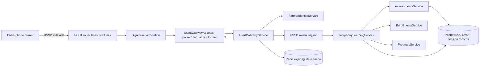
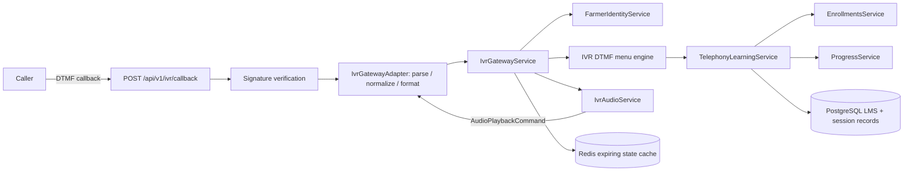
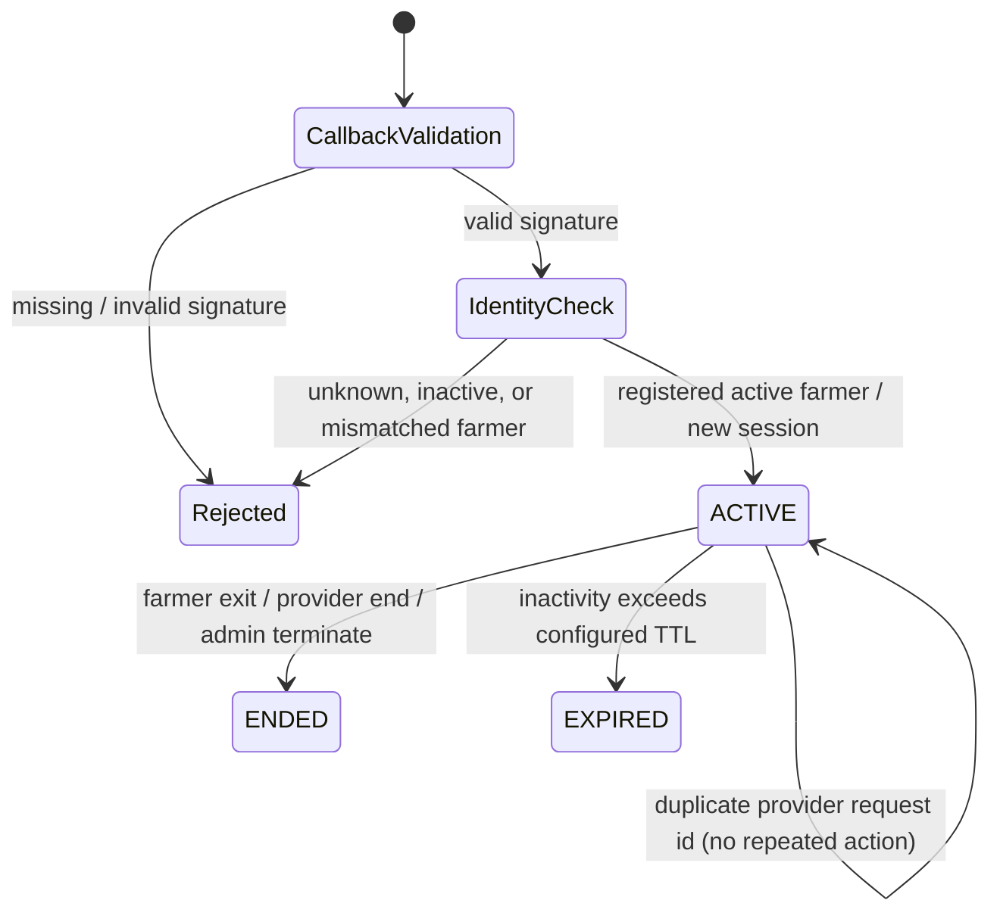
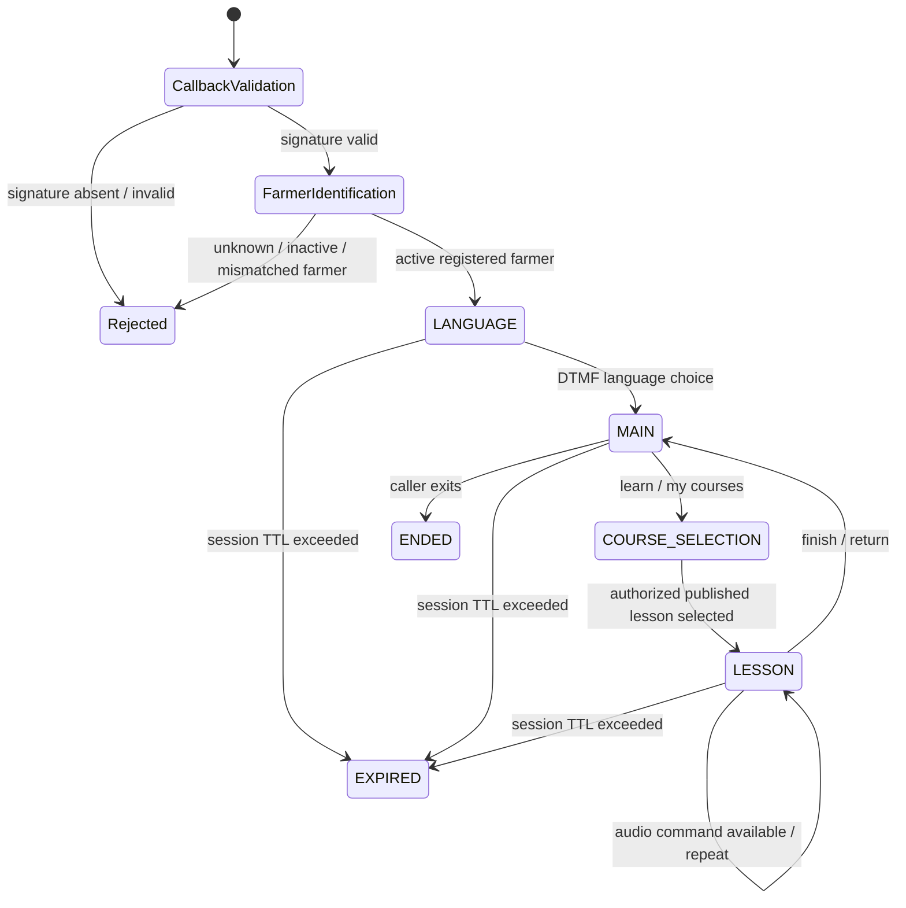
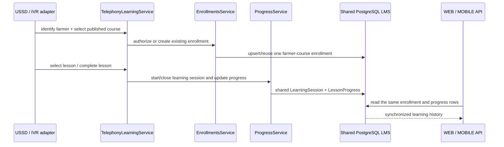

# Architecture

MenyaMuhinzi backend: NestJS (TypeScript), PostgreSQL 17 through Prisma 7, Redis 7 with BullMQ
queues, OpenAPI documentation at `/api/docs`. All routes are served under `/api/v1`.

## Layers

```text
src/
  main.ts, bootstrap/      HTTP setup: validation pipe, global error filter, Swagger, security headers
  config/                  Typed configuration and environment validation (fails fast at startup)
  infrastructure/          Prisma (database), Redis, BullMQ queues, logger
  common/                  Shared DTOs, filters, validation helpers, Rwanda reference data
  health/                  Liveness and readiness checks
  modules/                 Business modules (one folder per domain)
  generated/prisma/        Generated Prisma client (not edited by hand)
prisma/                    Schema, additive migrations, idempotent seed
test/                      Unit (next to sources), integration (`test/integration`), e2e (`test/*.e2e-spec.ts`)
```

Every business module follows the same shape: controller, then service, then Prisma. Authorization
uses `@Authorize({ roles, permissions })`. State changes write an audit entry in the same database
transaction (`AuditService.record(entry, tx)`). Prisma errors are mapped to HTTP responses by the
global filter (`P2002` → `409`, `P2025` → `404`).

## Delivered phases

| Phase | Scope                                                                                    |
| ----- | ---------------------------------------------------------------------------------------- |
| 0     | Project foundation, configuration, health, queues, logging                               |
| 1     | Authentication, users, roles and permissions, account requests, audit log                |
| 2     | Farmers, facilitators, crops, farmer groups                                              |
| 3     | Courses, modules, lessons, teaching materials, enrollments, progress, assessments        |
| 4     | Knowledge base: sources, versions, processing into chunks, review/approval, search rules |
| 5     | AI assistant management and orchestration foundation                                     |
| 6     | Notification and communication foundation (in-app inbox, templates, preferences)         |
| 7     | Reporting, analytics and monitoring (aggregates over transactional data, CSV export)     |

## Queues

| Queue                    | Producer                            | Consumer                                                               |
| ------------------------ | ----------------------------------- | ---------------------------------------------------------------------- |
| `knowledge`              | Knowledge sources                   | Document processing worker (Phase 4)                                   |
| `ai-generation`          | AI conversations service            | `AiRequestWorker` (Phase 5, `AI_WORKER_ENABLED`)                       |
| `notification-delivery`  | Notification publisher              | `NotificationDeliveryWorker` (Phase 6, `NOTIFICATIONS_WORKER_ENABLED`) |
| `media`                  | Not used yet                        | Later phases                                                           |
| `notifications` (legacy) | `AuthService` (password-reset jobs) | None. See the note under Notifications                                 |

Workers throw BullMQ `UnrecoverableError` for permanent failures (missing configuration, missing
provider) so they are not retried. Only transient errors use the configured attempts.

## AI foundation (Phase 5)

### What is and is not implemented

Implemented: assistant, model, model-configuration, prompt and safety-policy administration with
version history; user conversations and messages; AI request tracking through a queue; usage
records; response validation records; and a provider-independent orchestration pipeline.

Not implemented: **no AI provider is connected** (no OpenAI, Gemini, Hugging Face, Ollama or any
other), **no embeddings are generated**, **no vector database is installed**, and **no semantic
search runs**. No external AI request is made and no provider API key is read. The interfaces exist
as preparation for a later integration.

### Data model

```text
AiAssistant ──< AiAssistantVersion (snapshots)
     │ ├──< AiAssistantCrop >── Crop
     │ ├──< AiAssistantPrompt >── AiPromptTemplate ──< AiPromptVersion
     │ └──< AiAssistantModelConfiguration >── AiModel (primary / fallback) ──< AiModelVersion
     │
     └──< AiConversation ──< AiMessage
                  └──< AiRequest ──< AiRequestKnowledgeReference >── KnowledgeChunk
                           ├──── AiUsageRecord
                           └──< AiResponseValidation
AiSafetyPolicy ──< AiSafetyPolicyVersion
```

Database rules added by the migration `20261120131325_phase5_ai_assistant_foundation`:
at most one `ACTIVE` model configuration per assistant (partial unique index), fallback model
different from primary, default language among supported languages, chunk limit 0–50, positive
token limits, non-negative usage figures, and a currency whenever a cost is recorded.

### Request pipeline

```text
POST /ai/conversations/:id/messages
  → AiConversationsService: store user message (atomic sequence, idempotent clientRequestId)
  → AiOrchestratorService.plan: assistant usable? active model configuration? provider registered?
  → AiRequest CREATED → QUEUED (ai-generation job, job id = request id)
AiRequestWorker → AiOrchestratorService.execute
  1. KnowledgeRetriever    approved chunks only (Phase 4 approval rule), or UNAVAILABLE
  2. ContextBuilder        numbered sources within AI_CONTEXT_MAX_CHARS
  3. PromptAssembler       default prompt versions + active safety policies + context + question
  4. AiProvider            looked up by AiModel.provider in AI_PROVIDERS (empty today)
  5. ResponseValidator     structure, citations, uncited quantities, policy keywords
  → assistant AiMessage (only from a real provider), AiUsageRecord, AiResponseValidation
```

Today step 4 has no implementation, so every request ends `FAILED` with
`AI_MODEL_CONFIGURATION_MISSING` or `AI_PROVIDER_NOT_CONFIGURED`. No assistant message is stored.
The usage record is marked `NOT_AVAILABLE` with null tokens and cost. Assistants that require
sources fail with `AI_KNOWLEDGE_UNAVAILABLE` when retrieval cannot run, instead of answering
without sources. Source references are checked against the approval rule again before being stored,
so unapproved or inactive knowledge is never referenced.

The validator and safety policies are basic, rule-based checks. They do not guarantee that
agricultural advice is correct or safe; human review and real evaluation remain necessary.

### Interfaces (`src/modules/ai/orchestration/ai.interfaces.ts`)

| Token                 | Interface            | Default binding              |
| --------------------- | -------------------- | ---------------------------- |
| `AI_PROVIDERS`        | `AiProvider[]`       | `[]` (none)                  |
| `KNOWLEDGE_RETRIEVER` | `KnowledgeRetriever` | `ApprovedKnowledgeRetriever` |
| `CONTEXT_BUILDER`     | `ContextBuilder`     | `DefaultContextBuilder`      |
| `PROMPT_ASSEMBLER`    | `PromptAssembler`    | `TemplatePromptAssembler`    |
| `RESPONSE_VALIDATOR`  | `ResponseValidator`  | `BasicResponseValidator`     |

Embedding providers and vector stores are the Phase 4 interfaces in `KnowledgeModule`; none is bound.

### Adding a real provider later

1. Implement `AiProvider` (`id`, `generate(input)`). Throw `AiProviderError` with
   `retryable = true` for transient failures (timeouts, rate limits) and `false` otherwise. Return
   token counts and cost only when the provider reports them.
2. Read credentials from the provider's own environment variables or a secret store. Never put
   them in `AiModel` records (metadata containing secret-like keys or values is rejected).
3. Bind it: `{ provide: AI_PROVIDERS, useFactory: (p: MyProvider) => [p], inject: [MyProvider] }`.
4. Register an `AiModel` whose `provider` equals the implementation's `id`, activate it, then
   create and activate a model configuration for the assistant.
5. For retrieval, bind an `EmbeddingProvider` and a `VectorStore` in `KnowledgeModule`, activate an
   embedding configuration, and index approved chunks.
6. Add evaluation and human review before exposing generated advice to farmers.

Integration tests use clearly marked test doubles (`test/fixtures/ai-test-doubles.ts`); records
they produce are flagged `isTestData = true`.

## Notification foundation (Phase 6)

### What is and is not implemented

Implemented: an in-app inbox (list, detail, read/unread, read-all, archive, unread counts);
per-channel delivery records; multilingual templates with versions, history and validated
variables; user preferences (channels, categories, language, time zone, quiet hours); administrator
policy for categories and channels; internal publishing from business events; a queue-backed
dispatcher; and provider interfaces with a registry.

Not implemented: **no SMS (MTN, Airtel or gateway), email, push (Firebase), WhatsApp, USSD or IVR
provider is connected**, no provider credentials are read and no external network request is made.
The interfaces are preparation only. The in-app inbox is the only channel that delivers.

### Data model

```text
Notification ──< NotificationDelivery (one per channel, unique per notification + channel)
NotificationTemplate ──< NotificationTemplateVersion   (unique code + channel + language)
NotificationCategorySetting (per category)      NotificationChannelSetting (per channel)
NotificationPreference ──< NotificationChannelPreference
                       └──< NotificationCategoryPreference
```

Migration `20261120140115_phase6_notifications_foundation` is additive. Database rules: a
non-inbox delivery cannot be `SENT` or `DELIVERED` without a provider id, `DELIVERED` needs a
timestamp, attempts are non-negative, `ACCOUNT`, `ACCOUNT_APPROVAL` and `SECURITY` must stay
essential and active, `IN_APP` must stay allowed, and quiet hours need a valid, complete,
`HH:mm` window. `(userId, dedupeKey)` makes publishing idempotent.

### Publishing pipeline

```text
business event (for example account approved)
  → NotificationPublisher.notifyEvent        never throws; failures are logged only
     1. load recipient, dedupe check
     2. category policy (active? essential?) and user preferences (non-essential, category opt-out)
     3. render the IN_APP template (user language, then the other language), validate variables
     4. plan every requested channel:
          not allowed for the category / unsupported for the account / disabled by an administrator /
          no provider / no address / disabled by the user / no active template / invalid variables
          → SKIPPED with a reason code
          otherwise → QUEUED (delayed to the end of quiet hours unless the category is essential)
     5. one transaction: notification, IN_APP delivery (DELIVERED), planned deliveries
     6. enqueue QUEUED deliveries on notification-delivery (job id = delivery id);
        an enqueue failure marks that delivery FAILED (NOTIFICATION_QUEUE_UNAVAILABLE)
NotificationDeliveryWorker → NotificationDispatcher.execute
  claim QUEUED → PROCESSING (conditional update, so duplicate jobs send nothing twice)
  re-check user and channel, find the provider, hand the message over
  → SENT (provider id, provider message id, isTestData for test doubles)
  retryable provider error → back to QUEUED and retried; otherwise FAILED (NOTIFICATION_PROVIDER_ERROR)
```

The dispatcher never writes `DELIVERED`: that needs a provider receipt, which does not exist yet.
Provider error text is neither stored nor logged (it can contain addresses or credentials).

### Policy

- Supported channels per account: basic-phone farmers `IN_APP`, `SMS`, `USSD`, `IVR`; everyone else
  `IN_APP`, `SMS`, `EMAIL`, `PUSH`. Users with several roles get the union. Nobody has to
  configure email, and the inbox cannot be disabled.
- Essential categories (`ACCOUNT`, `ACCOUNT_APPROVAL`, `SECURITY`) are locked: they reach the inbox
  whatever the preferences, ignore quiet hours and cannot be disabled by users or administrators.
  An explicit opt-out of an external channel by the user is still respected.
- A channel can only be enabled (by an administrator, and then by a user) when it is supported, a
  provider is registered for it and, for email, an address exists.

### Templates

Identified by `code` + `channel` + `language`; every change to text or variables is a new version.
Variable types are `string`, `number` and `date`. Rendering validates all values first, inserts them
in a single pass as plain text (no HTML, control characters removed, no nested placeholders) and
enforces per-channel limits (SMS 480, USSD 160, push 240, IVR 1000, email 20000 characters).
Nothing is translated automatically. The Kinyarwanda system templates are seeded as `DRAFT`
and need review by a native speaker before activation.

### Interfaces (`src/modules/notifications/providers/`)

| Token                    | Interface                | Default binding |
| ------------------------ | ------------------------ | --------------- |
| `NOTIFICATION_PROVIDERS` | `NotificationProvider[]` | `[]` (none)     |

`NotificationProviderRegistry` answers `forChannel`, `canDeliver` and `describe`.

### Adding a real provider later

1. Implement `NotificationProvider` (`id`, `channels`, `send(message)`). Throw
   `NotificationProviderError` with `retryable = true` only for transient failures.
2. Read credentials from the provider's own environment variables or a secret store.
3. Bind it: `{ provide: NOTIFICATION_PROVIDERS, useFactory: (p: MyProvider) => [p], inject: [MyProvider] }`.
4. An administrator enables the channel (`PATCH /admin/notifications/channels/:channel`) and
   reviews or activates templates for it.
5. For `DELIVERED`, add a receipt webhook or poller that records the confirmation.
6. Consider opt-out and consent rules, rate limits and message cost before sending to farmers.

Integration tests use a clearly marked test provider (`test/fixtures/notification-test-doubles.ts`);
its deliveries are flagged `isTestData = true`.

### Legacy `notifications` queue

`AuthService` still adds `password-reset` jobs, which contain the reset token in plaintext, to the
legacy `notifications` queue. Nothing consumes them. They predate Phase 6 and were left untouched
so earlier behaviour is unchanged; they should be removed or redesigned (no token in the job)
before any email or SMS password-reset delivery is built.

## Reporting foundation (Phase 7)

### What is and is not implemented

Implemented: institutional, facilitator-scoped and farmer-personal report endpoints; date-range
filters; active-learner window (`REPORTS_ACTIVE_LEARNER_DAYS`); CSV export for selected admin
reports with formula sanitisation and row limits; indexes on enrollment, session, attempt and
progress timestamps.

Not implemented: no BI warehouse, no nightly rollup tables, no live BullMQ Redis depth API, no PDF
or Excel export, no cross-role report caching.

### Calculation definitions

| Metric                         | Definition                                                                                                            |
| ------------------------------ | --------------------------------------------------------------------------------------------------------------------- |
| Date range                     | `startDate` inclusive, `endDate` exclusive (UTC)                                                                      |
| Active learner                 | `ACTIVE` enrollment and a learning session or lesson progress touch within the last N days ending at `endDate` or now |
| Course completion rate         | `COMPLETED / (ACTIVE + COMPLETED)` for a course; `null` when both are zero                                            |
| Assessment pass rate           | `PASSED / (PASSED + FAILED)`; in-progress attempts are abandoned, not failures                                        |
| Knowledge processing success   | `COMPLETED / (COMPLETED + FAILED)` jobs                                                                               |
| AI tokens                      | Sum of non-null provider-reported values; `NOT_AVAILABLE` records counted separately                                  |
| External notification delivery | Never claimed as `DELIVERED` without a provider receipt (only IN_APP is delivered today)                              |

### Authorization

Administrators use `reports:read` / `reports:export`. Facilitators use `facilitator-reports:*` and
may only see farmers in groups they lead. Farmers use `farmer-reports:read` for their own rows.
Export actions write an audit entry without storing exported row contents.

### Indexes (migration `20261123084214_phase7_reports_indexes`)

`course_enrollments(enrolledAt)`, `learning_sessions(startedAt)`, `learning_sessions(channel, startedAt)`,
`assessment_attempts(startedAt)`, `assessment_attempts(status, startedAt)`,
`lesson_progress(lastAccessedAt)`.

## USSD and IVR (Phase 8)

Telephony channels are adapters around the existing LMS, not separate learning systems. The
registered adapter verifies and parses provider-specific input; `TelephonyLearningService` applies
course visibility and enrollment checks; progress and learning-session writes use the existing
services. PostgreSQL is the source of truth for sessions and learning history. Redis stores expiring
menu-state cache entries; session state is also persisted in PostgreSQL for recovery. No provider
adapter or audio provider is registered by default.

### USSD architecture



### IVR architecture



The audio boundary only creates a provider command; it does not play or deliver audio itself.
Without an `AUDIO_PROVIDERS` implementation, lesson playback returns an explicit unavailable
response and does not create a learning session for audio that was not delivered.

### USSD session lifecycle



### IVR call lifecycle



### Cross-channel learning synchronization



### Provider payload and security boundary

Adapters own the provider-specific payload contract. The included test adapters accept an example
shape such as:

```json
{
  "sessionId": "provider-session-123",
  "callbackId": "provider-event-456",
  "phoneNumber": "+250788123456",
  "text": "1"
}
```

The IVR test adapter uses `digits` instead of `text`. Signatures use the configured channel-specific
secret; the test adapters use `x-ussd-signature` and `x-ivr-signature`. Stable provider callback ids
are used for retry idempotency. Without one, identical DTMF/menu input may be a valid next choice,
so adapters must supply an id where the provider supports it. Callbacks are globally rate-limited
by the existing HTTP throttler. No provider secrets, authentication tokens, or farmer details are
logged.

| Token                     | Interface                 | Default   |
| ------------------------- | ------------------------- | --------- |
| `USSD_GATEWAY_PROVIDERS`  | `UssdGatewayAdapter[]`    | `[]`      |
| `IVR_GATEWAY_PROVIDERS`   | `IvrGatewayAdapter[]`     | `[]`      |
| `AUDIO_PROVIDERS`         | `AudioProvider[]`         | `[]`      |

Migration: `20261123120000_phase8_ussd_ivr_foundation` (`ussd_sessions`, `ivr_sessions`, and
`telephony_channel_settings` with CHECK constraints on channel, TTL and screen length). Channel
settings are disabled until enabled by an administrator. Session expiry is enforced when callbacks
arrive; persistent progress does not depend on Redis.

USSD exposes published multiple-choice and true/false assessments for enrolled courses. Answers are
graded by `AssessmentsService`; correct answers are not included in the menu state or prompts, and
an in-progress attempt is reused after a callback retry. Short-answer assessments and IVR assessment
flows are not exposed. No real telecom, text-to-speech, or audio-asset provider is connected.

## Security

Passwords are stored as hashes only; hashes and tokens never appear in responses. Secrets come
from environment variables (`.env.example` lists them without values). AI model metadata and
configuration are scanned for secret-like content and rejected without echoing it. Users can only
see their own conversations and requests; administrators viewing someone else's are audited.
Reports omit phone numbers, emails, tokens and notification bodies.
